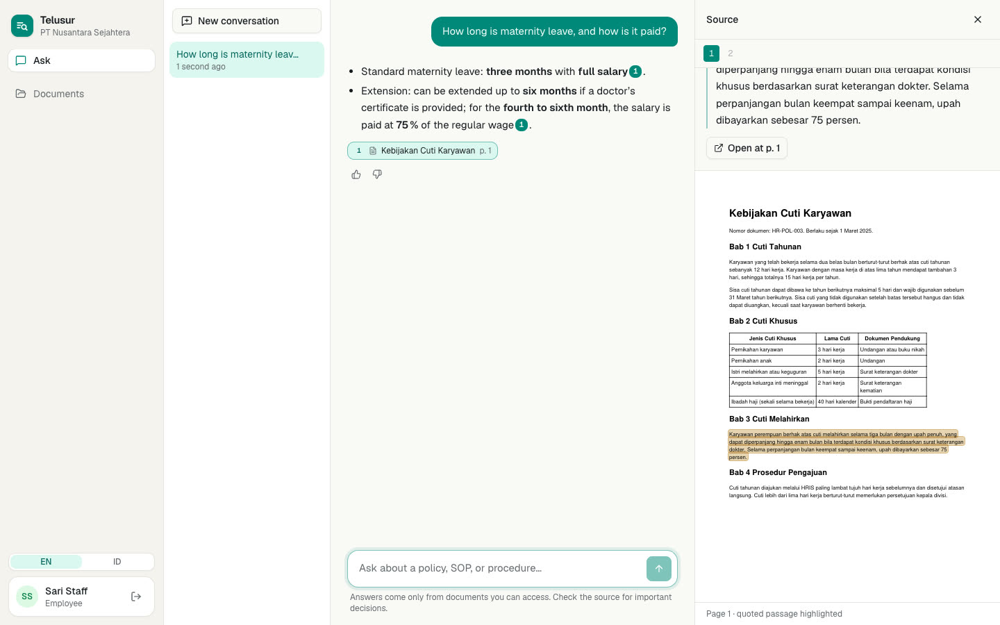

# Telusur

**English** · [Bahasa Indonesia](README.id.md)

**[▶ Watch the 2:54 demo and case study](https://geffaa.github.io/telusur/)** · video: [`docs/telusur-demo.mp4`](docs/telusur-demo.mp4)

[](https://geffaa.github.io/telusur/)

An internal knowledge assistant (RAG) for companies: answers from internal documents, with
citations, drawn only from documents the person asking is allowed to read. The interface is in
English and Indonesian (switcher in the sidebar). Full plan: [BREAKDOWN.md](BREAKDOWN.md)
(Indonesian).

**Status:** milestones 1–4 done, milestone 5 partly (quote highlighting in PDFs, load test; VPS
deployment pending). Multi-tenant with row-level security; PDF/DOCX/Markdown ingestion with
structure-aware chunking; per-collection and per-document access; hybrid retrieval (vector +
full-text + RRF + reranker); streaming chat with citations that open the source page; refusing to
answer when no source exists; document versioning; append-only audit log; unanswered questions
grouped by topic; feedback; user and group management; an "access check" simulator; and an
evaluation harness with measured results (below).

## Stack

| Part | Technology |
|---|---|
| Frontend | Next.js 15, shadcn/ui, TanStack Query, PDF.js |
| API | FastAPI, SQLAlchemy 2 (async), Alembic |
| Worker | arq + Redis |
| Database | Postgres 16 + pgvector (HNSW) + full-text search, row-level security per tenant |
| Embeddings | `BAAI/bge-m3`, local (multilingual, 1024 dims, free) |
| Reranker | `BAAI/bge-reranker-v2-m3`, local |
| LLM | Groq free tier (`gpt-oss-120b` answers, `gpt-oss-20b` rewrites and judging); Gemini / Ollama fallback |

## Run locally

Requires Docker, [uv](https://docs.astral.sh/uv/), and Node 20+.

```bash
docker compose up -d                       # Postgres :5441, Redis :6390

cd apps/api
cp .env.example .env                       # set JWT_SECRET and GROQ_API_KEY (free at console.groq.com)
uv sync
uv run alembic upgrade head
uv run python -m scripts.make_sample_docs  # fictional documents into ../../samples
uv run python -m scripts.seed              # 2 tenants, groups, access rules, 22 indexed documents
uv run uvicorn app.main:app --port 8000    # terminal 1
uv run arq app.worker.WorkerSettings       # terminal 2 (downloads bge-m3, ~2.2 GB, the first time)

cd ../web
cp .env.local.example .env.local
npm install && npm run dev                 # http://localhost:3000
```

Demo sign-in: workspace `nusantara`, password `telusur123`:

| Email | Role | What to try |
|---|---|---|
| `hr@nusantara.test` | Knowledge Admin | upload, set access, inspect indexed chunks |
| `staff@nusantara.test` | Employee (Staff) | ask questions; the pay-structure document is invisible |
| `direksi@nusantara.test` | Employee (Director) | the same question about director pay gets answered |
| `admin@nusantara.test` | Tenant Admin | manage users and groups, audit log |

A second tenant, `garuda`, is fully isolated. The company and its documents are fictional and in
Indonesian; English questions are answered from them.

## Record the demo again

With the API, worker and web running and the demo data seeded:

```bash
cd demo && npm install && node record.mjs   # → demo/out/telusur-demo.mp4 (needs ffmpeg and Chrome)
```

The script records each scene with Puppeteer's screencast, with a visible cursor and captions,
then joins the clips into an H.264 MP4 with ffmpeg.

## Tests

```bash
cd apps/api && uv run pytest
```

Includes tenant-isolation tests (RLS) and access-leak tests: a restricted document never reaches
retrieval for other groups (not even admins), revoking access applies immediately, source files
return 404 to people without access, conversations are private to their owner, and API errors
follow the request's language.

## Evaluation results

Measured with `python -m app.eval` on a corpus of 22 fictional policy documents (232 chunks) and
71 test cases: 58 answerable questions (~30% in English), 10 questions the documents don't
answer, and 3 questions about a document the asker may not read.

| Configuration | Recall@1 | Recall@5 | MRR | Correct refusals | False refusals |
|---|---|---|---|---|---|
| Keyword only | 0.60 | 0.91 | 0.71 | n/a | n/a |
| Vector only (bge-m3) | 0.84 | 0.95 | 0.89 | n/a | n/a |
| Hybrid (vector + keyword, RRF) | 0.72 | 0.97 | 0.83 | n/a | n/a |
| Hybrid + rerank, no query translation | 0.95 | 1.00 | 0.97 | 0.92 | 0.10 |
| Hybrid + rerank, one translation | 0.97 | 1.00 | 0.98 | 1.00 | 0.02 |
| **Hybrid + rerank, three paraphrases (production)** | **0.97** | **1.00** | **0.98** | **1.00** | **0.00** |

Answer quality of the production configuration (answered by `gpt-oss-120b`, graded by a
`gpt-oss-20b` judge):

| Faithfulness | Correctness | Answers with citations | Restricted documents leaked |
|---|---|---|---|
| 0.97 | 0.94 | 93% | 0 of 3 |

What the numbers taught:

- **The reranker is the component that matters.** It lifts Recall@1 from 0.84 to 0.97 and is the
  only score calibrated enough to decide "I don't know".
- **Hybrid without reranking was worse than vector alone** (MRR 0.83 vs 0.89): keyword search
  pulls loosely related passages up. It pays off only as a candidate source for the reranker.
- **Query translation cut false refusals from 10% to 2%, three paraphrases to 0%.** Every false
  refusal was an English question whose right passage was already ranked first, but cross-lingual
  reranker scores were too low. A single translation sometimes picks words the documents don't
  use ("maternity leave" → "cuti hamil" instead of "cuti melahirkan"), so non-Indonesian questions
  are now searched with three Indonesian phrasings and each passage keeps its best rerank score.
  The price: retrieval for non-Indonesian questions takes about 3× as long as for Indonesian ones.
- **The 0.35 "I don't know" threshold was chosen from data:** anything in 0.34–0.40 refused all 13
  negative cases while wrongly refusing 1 of 58 (before the paraphrase change).

Known limitations:

- Test cases are generated by an LLM from document chunks, then filtered for ambiguity. Such
  questions tend to be easier than real employee questions; manual verification is available on
  the Evaluation page, and a 👎 rating can become a test case.
- There are only 13 negative cases, so the threshold should be recalibrated as data grows.
- The 2 wrong answers were both "who does policy X cover?" questions: the model narrowed the scope
  on its own. The LLM judge is also occasionally inconsistent; answer scores need manual spot
  checks.
- Latency was measured on a laptop (Apple Silicon, MPS) with the API and worker running; p50 of
  ~1.5 s is dominated by the reranker.

Reproduce:

```bash
cd apps/api
uv run python -m app.eval generate                             # build the test set (LLM)
uv run python -m app.eval run --mode vector                    # or lexical, hybrid, hybrid_rerank
uv run python -m app.eval run --mode hybrid_rerank --answers   # + answer quality (~30 min on the free tier)
uv run python -m app.eval compare                              # comparison table
```

Or from the UI: **Evaluation → Run evaluation** (runs in the worker, with progress and a
per-question comparison between runs).

## Load test

`python -m scripts.loadtest` runs virtual users that keep asking questions (from the evaluation
set, a new conversation each time) and read the answer stream to the end. The API runs with
`FAKE_LLM=true`: the LLM is replaced by a canned reply with a 0.7 s time to first token, so the
numbers below measure this system (embeddings, search, reranker, database), **not** Groq's
free-tier rate limit. One API process on an Apple Silicon laptop (MPS), 45 seconds per level.

| Concurrent users | Chats/min | First token p50 | p95 | Errors |
|---|---|---|---|---|
| 1 | 26 | 2.1 s | 2.6 s | 0% |
| 5 | 42 | 6.9 s | 7.4 s | 0% |
| 10 | 38 | 15.0 s | 16.9 s | 0% |
| 20 | 32 | 35.7 s | 37.1 s | 0% |

Found and fixed:

- **Crash at 5 concurrent users.** The embedder and the reranker each had their own lock, so both
  could use the GPU at once; the MPS backend aborted the process (Metal assertion). All model
  inference now goes through one lock (`app/device.py`).
- **Database connection pool exhausted at 20 users.** Each request held a connection while waiting
  for the GPU. Connections are now used only for the search queries; embedding happens before and
  reranking after.

The ceiling is the reranker (~1 s for 20 candidates), run one request at a time on one GPU, so
throughput tops out at ~40 chats/min and latency grows linearly beyond that. The
`RERANK_CANDIDATES` setting is a measured trade-off:

| `RERANK_CANDIDATES` | Recall@1 | Recall@5 | Peak chats/min | p95 at 20 users |
|---|---|---|---|---|
| 20 (default) | 0.97 | 1.00 | 42 | 37 s |
| 10 | 0.95 | 0.98 | 65 | 21 s |

The default stays at 20 for quality; for high traffic, the next steps are a dedicated inference
GPU, batching reranks across requests, or several API replicas behind a load balancer.

```bash
FAKE_LLM=true uv run uvicorn app.main:app --port 8001     # separate terminal
uv run python -m scripts.loadtest --base http://localhost:8001 --users 1 5 10 20
```

## Design decisions

- **Postgres row-level security, not just `WHERE tenant_id`.** Every transaction runs
  `set_config('app.tenant_id', …, true)` (see `app/db.py`). The app uses a non-superuser role,
  `telusur_app`, so even a bug in the code can't leak data across tenants.
- **Chunking follows document structure.** A chunk never crosses a heading, tables are never cut
  (large tables split by rows with the header repeated), and every chunk carries its
  `heading_path` and page numbers for citations.
- **Contextual header for embeddings.** Embedded text starts with the document title and section,
  so short chunks such as tables can still be found.
- **Idempotent, crash-safe ingestion.** A retry deletes the version's chunks before inserting; on
  startup the worker re-queues versions left mid-pipeline.
- **Access control inside the retrieval query.** The access filter is part of the vector and
  full-text SQL, so a forbidden chunk never reaches the reranker or the LLM. Access is evaluated
  live from group membership.
- **"I don't know" before calling the LLM.** When the top reranker score is below the threshold
  (0.35), the LLM is not called at all: cheaper, and nothing to hallucinate.
- **Verified citations.** Citation numbers that don't exist in the context are removed; quotes are
  stored as snapshots and hidden if the reader later loses access to that document.
- **An audit log that can't be changed.** The app role only has INSERT/SELECT, and a trigger
  rejects UPDATE/DELETE even for the database owner. The table is partitioned by month (2026–2027
  plus a default partition; add partitions with an ops job before 2028).
- **Unanswered questions grouped by meaning,** so admins see missing topics ("glasses allowance",
  2 askers) rather than a list of differently worded sentences.
- **Quotes highlighted inside the PDF.** The source panel renders the page with PDF.js and
  highlights the text that belongs to the quote; only the largest contiguous block is highlighted
  so a phrase repeated elsewhere on the page is not lit up.
- **Two languages without a translation library.** Interface text lives in typed per-area
  dictionaries; the Indonesian table must have exactly the English keys, so a missing translation
  fails the build. API errors carry a stable code and are rendered in the request's language;
  ingestion errors are stored as codes and translated for whoever reads them.
- **Atomic version switch.** New chunks and the `is_current` switch happen in one transaction.
